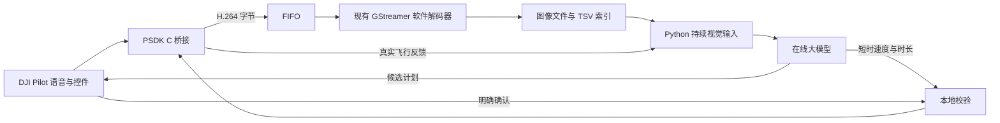

# M300 语音任务与大模型视觉控制

这是面向 M300 配套 **Jetson/Linux 机载计算机**的独立源码包。保留语音识别、在线任务规划、纯视觉短时运动决策、DJI Pilot 人工确认、持续视觉反馈和分析期间悬停，移除了仿真动力学、固定气球坐标、视频回放和模拟碰撞反馈。

本目录可以独立迁移，不需要引用旁边的 `uav-voice-planner`。但 M300 本体不直接运行 Python：Python 在 Jetson 上运行，C 桥接模块加入现有 PSDK 应用，由该应用调用飞控和遥控器接口。**仍需在机载设备上编译 PSDK 桥接、填写密钥，并完成现场接口验收，不能把本机测试通过视为已经可以直接起飞。**

## 已核对的设备与视觉接口

用户提供的 `offline_balloon_strike_test/PROJECT_OVERVIEW.md` 记录：Jetson Orin NX Engineering Reference Developer Kit、ARM64、Ubuntu 22.04.5 LTS、L4T R36.4.3、Python 3.10。原项目记录的 PSDK 为 3.9.2 beta。整理时设备 SSH 不可达，上述为本地交接资料信息，不是本轮在线设备查询结果。

视觉接口沿用这份代码的发布格式：



现有解码器和新 Python 程序可以共享图像发布目录。**新 Python 程序不读取 H.264 FIFO，也不与解码器抢读。** 同一个 FIFO 只运行一个解码器，H.264 也只保留一个生产者。

## 目录

```text
app/
  asr.py                 PSDK 语音解码和 whisper.cpp 识别
  model.py               两类真实 API 请求和原始输入/返回记录
  mission.py             当前计划、修改、确认、拒绝、暂停、完成记录
  vision.py              读取既有 Liveview 图像与带时钟标识的 TSV
  clock.py               与原视觉目录一致的 monotonic/boot 时钟协议
  control.py             速度、时长、目标和状态检查
  runtime.py             异步任务处理和 20 Hz 状态/控制发布
  liveview_decoder.py    可选独立解码器，兼容原发布格式
psdk/
  m300_runtime.c/.h       Widget、语音上传、Liveview、遥测、飞控桥接
  command_guard.c/.h     独立于 Python 的控制放行与超时检查
  host_integration.c     从环境变量定位迁移包的集成入口
  widget/                DJI Pilot 控件 JSON 与图标
scripts/                 安装、启动、输入路径绑定和测试
config/                  现场验收说明
third_party/             whisper.cpp 和模型的放置说明
backups/                 原项目源码备份与 SHA-256 清单
.env                     仅有占位密钥的配置
```

## API Key 填在哪里

**编辑本目录根部的 `.env`，把下面这一行中的 `Your API Key` 换成自己的密钥：**

```dotenv
OPENAI_API_KEY=Your API Key
OPENAI_BASE_URL=https://api.deepseek.com
OPENAI_CHAT_MODEL_ID=deepseek-flash
```

仓库中的 `.env` 只包含 `Your API Key` 占位符，没有复制旧项目的真实 Key。填写后请保留 `.env` 的仅当前用户可读写权限（`chmod 600 .env`）。

若使用学校或其他兼容服务，须同时填写对应的 `OPENAI_BASE_URL` 和有权限的模型名称。模型必须支持 `image_url` 图片输入。服务端的 `deepseek-flash` 名称可能是路由别名，不能据名字推断模型能力，应在目标网络上重新验证。API Key、服务地址、模型名不能跨服务商随意混用。

不要把 `.env` 当 Shell 脚本 `source`。由 Python 配置加载器读取，允许占位值中有空格。填写真实密钥后不要分享或提交该文件；`.env` 已被 Git 跟踪，`.gitignore` 不会阻止它的后续修改进入提交。启动时环境中的 `OPENAI_*`、`UAV_*` 同名项会覆盖 `.env`，排查配置时请留意。

## 机载安装

在 Jetson 上解压整个目录，进入项目根目录：

```sh
sudo apt-get install python3-venv libopus0 build-essential cmake git curl
sh scripts/install-python.sh
sh scripts/install-whisper.sh
```

软件识别使用本机编译的 whisper.cpp 和多语言 `ggml-base.bin`。安装与编译步骤见 `third_party/README.md`。旧项目的模型文件可以复用，但 **macOS 编译出的 whisper-cli 不能在 Jetson ARM64 上运行**。本目录不复制虚拟环境、SDK 二进制或本机编译产物。

如果继续使用设备已有的解码器，不需要给 Python 再安装 OpenCV。只有使用本包的可选解码器时，才需要 Jetson 上启用了 GStreamer 的系统 OpenCV；不要用普通 pip OpenCV 覆盖现有可用的系统版本。

所有项目资源默认相对本目录定位，与调用命令时的工作目录无关。Linux `/proc` 时钟标识属于系统接口，不是写死的项目安装目录。

## 绑定现有 Liveview 输入

原目录记录的设备接口为 FIFO `/tmp/balloon_liveview.h264`、图像目录 `/dev/shm/balloon_liveview_frames`、索引 `/dev/shm/balloon_liveview_latest.tsv`。在 Jetson 上执行：

```sh
.venv/bin/python scripts/link-liveview.py \
  --fifo /tmp/balloon_liveview.h264 \
  --frame-dir /dev/shm/balloon_liveview_frames \
  --metadata /dev/shm/balloon_liveview_latest.tsv
```

这只创建本包 `inputs/` 下的符号链接，不启动、停止或修改现有服务。若设备路径不同，改命令参数即可。

默认 `.env`：

```dotenv
UAV_LIVEVIEW_METADATA=inputs/liveview_latest.tsv
UAV_LIVEVIEW_FRAME_DIR=inputs/liveview_frames
```

支持的索引是**五列，以制表符分隔**：

```text
frame_id    decoded_monotonic_ms    encode_ms    image_path    mono-v1:<Linux boot_id>
```

图像旁还须存在同名 `.jpg.tsv` 或 `.bmp.tsv`，内容为三列：

```text
decoded_monotonic_ms    image_filename    mono-v1:<Linux boot_id>
```

程序检查本次开机时钟、索引与 sidecar 一致性、图像目录、时间戳新鲜度与帧编号，拒绝过期图像和重复帧，不通过文件修改时间猜测图像年龄。BMP 会转换成 JPEG 后交给 API。

时间戳表示解码后的帧时间，不等同于相机曝光时间；没有宣称消除了机载图传和编码缓存延迟。复制旧目录中的历史图片或 TSV 不能当作实时输入。

每次视觉决策传入三张连续原始画面、实际速度/高度/航向、最近六段动作效果和生效任务。API 曾识别到绿色的历史画面最多保留三张，明确标为历史绿色画面。本地 YOLO 框、颜色检测结果、目标方位或仿真世界坐标不作为模型输入。

## PSDK 桥接与遥控器确认

遥控器界面采用 [DJI PSDK 自定义控件](https://developer.dji.com/doc/payload-sdk-tutorial/en/function-overview/basic-function/custom-widget.html)：`DjiWidget_Init`、配置目录注册、`DjiWidget_RegHandlerList`，以及 `DjiWidgetFloatingWindow_ShowMessage`。通过 `SetWidgetValue` 接收操作，`GetWidgetValue` 让一次性按钮恢复松开状态。候选计划摘要不超过 SDK 的浮窗长度限制，显示线程与 20 Hz 控制线程分开。

新应用独占 Widget、FC subscription、Joystick 与 Liveview 模块。**不要同时运行旧版自主接近控制器或默认飞控示例**，也不要让另一处代码重复初始化/订阅这些模块。已有纯解码器可以继续运行。

### 加入现有 PSDK 构建

在现有 PSDK 应用的 CMake 配置中，用项目实际位置配置：

```cmake
set(DJI_PSDK_ROOT "${CMAKE_CURRENT_SOURCE_DIR}/你的SDK相对位置")
add_subdirectory("${CMAKE_CURRENT_SOURCE_DIR}/迁移包相对位置/psdk" m300_voice_runtime)
target_link_libraries(你的PSDK可执行目标 PRIVATE m300_voice_runtime)
```

`DJI_PSDK_ROOT` 必须指向有 `psdk_lib/include` 和官方 `samples/sample_c/module_sample/utils/cJSON.h` 的完整 SDK 树。宿主 PSDK 应用继续提供 SDK 平台适配、账户激活、通信接口、平台对应 `libpayloadsdk.a` 和 `cJSON.c`。本包不伪造这些数据，也不附带 DJI 的账户密钥。

在宿主已完成 `DjiCore_Init`/`DjiCore_ApplicationStart` 后的**用户任务**中，用真实 RID 配置调用：

```c
#include "m300_runtime.h"
/* ridInfo 来自设备现有的真实配置，不能用虚构坐标。 */
T_DjiReturnCode rc = M300Runtime_StartFromEnvironment(&ridInfo);
/* 若 rc 失败，记录错误并退出当前应用，不继续启动其他控制样例。 */
```

进程退出前调用 `M300Runtime_Stop()`。调用位置须遵循 FC subscription 要求的用户任务/调度器时序。程序初始化失败后请重启进程，不在同一进程反复启动桥接。

给宿主 PSDK 进程设置 `M300_RUNTIME_ROOT` 为迁移目录实际位置（由启动脚本动态定位），例如：

```sh
export M300_RUNTIME_ROOT="$(pwd)"
export M300_ALLOW_FLIGHT=0
# 可选：1/2/3 为挂载位置，7 为 FPV；默认位置 1。
export M300_CAMERA_POSITION=1
# 默认 0。H20 的 1=广角、2=变焦，须按设备实际镜头选择。
export M300_CAMERA_SOURCE=0
```

默认集成入口使用 `state/`；若要改状态目录，必须同时用低层 `M300Runtime_Start` 参数和 Python `UAV_STATE_DIR` 配成同一路径，不能只改其中一端。

### 人工确认的操作

DJI Pilot 会显示本包控件和浮窗。任务修改不会自动继续飞行：

1. 语音识别与规划完成后，浮窗显示新计划、版本号和已完成目标。
2. 点“查看计划/准备”，锁定这一份候选计划。飞行开关打开时，此步才请求 SDK 控制权。
3. 核对内容，再点“确认执行”。只有计划版本、内容摘要、确认随机标识和进程会话均匹配，才允许继续。
4. 点“拒绝计划”会保持暂停。可重新说话布置任务，新候选计划再次确认。
5. 点“暂停任务”立即撤销当前动作并保持暂停。“释放控制/接管”同时归还 SDK 控制权。

确认等待没有自动超时放行。未确认、拒绝、旧回执、旧 API 结果或旧进程文件都不能恢复运动。任务进行中重新说话会废弃旧确认，保留已完成记录，再生成新候选。

按 PSDK 语音接口接收的是带码率信息的 Opus 数据，不直接当成 PCM；本包按官方 speaker 样例的固定码率帧格式解码为 16 kHz 单声道 PCM，并验证传输 MD5 后交给 whisper.cpp。

**开始录音不等于机载程序已收到语音。** 机载程序在 PSDK 语音传输 START 到达时中断；此前的遥控器录音/传输延迟不在机载控制范围。需要立即停车时直接使用暂停控件或遥控器接管，不等待识别和云端模型。

### 完成判定和起飞范围

本包没有模拟碰撞传感器，也没有把目标消失当作撞击成功。当前阶段由操作者核实后点“确认目标完成”，写入真实的人工完成事件并切换下一目标。若以后接入接触传感器，应使用独立的真实完成事件源，不能让模型自行声称完成。

初版真机接口采用**人工起飞到稳定高度，再交给已确认任务**。不自动解锁电机、起飞或降落。高度是相对 home point 的气压/融合高度差，不是地形测得的真实 AGL。以前的仿真自动起飞逻辑已移除，未伪装成实机能力。

## 启动与实测顺序

先填写 `.env`，安装 ARM64 识别程序、绑定实时输入，执行：

```sh
sh scripts/run.sh --check
```

检查报告不打印 Key。没有 PSDK 遥测、实时图像或正确识别程序时，不会伪造成功输入。

第一阶段保留两个开关为 0：Python `.env` 的 `UAV_ENABLE_FLIGHT=0`，PSDK 进程的 `M300_ALLOW_FLIGHT=0`。先启动解码器和新宿主 PSDK 程序，再运行：

```sh
sh scripts/run.sh
```

此时接收真实输入、执行真实语音识别和真实 API 候选生成，但桥接代码不会调用发送运动或获取控制权的接口。可以检查遥控器上显示的计划、确认/拒绝/重新布置流程和模型速度输出。

进入现场飞行测试，必须在设备确认编译、控件和状态测试通过后，同时启用两个开关，并使用遥控器查看和确认本次计划。代码默认上限为水平 0.5 m/s、垂直 0.2 m/s、转向 5 deg/s，每段 0.1–0.5 s，只允许相对 home 高度 2–10 m 内的空中状态。上下限在 Python 与 C 两端各有校验，单改提示词不能放宽。

每次任务确认后默认最多进行 100 次视觉决策（`UAV_MAX_VISUAL_DECISIONS`），用尽后暂停，重新布置并确认才能继续。

模型自己生成短时指令。C 端仍独立核对授权、版本、单调时钟、会话、遥测新鲜度、速度和截止时间。Python 心跳超过 150 ms 未更新或动作到期时，C 端转为零指令；失去控制权后不再争抢控制权。SDK 的零速度稳定模式用于悬停，不能理解成瞬间停止。本包不关闭 DJI 避障或改写遥控器失联策略。

## 测试与记录

```sh
PYTHON=.venv/bin/python sh scripts/test.sh
```

测试使用接口隔离和小型固定数据验证状态机、时钟、格式和边界，不生成仿真视频，不运行真实飞控。测试目录的桩只供测试，生产入口不导入它们。

- `state/api-transcript/<call_id>/request.json`：实际发给模型的消息和图片。
- `response.json`、`timing.json`：原始模型返回、模型名、response ID、实际耗时。
- `state/logs/events.jsonl`：RC 操作、接受的原始模型速度、版本和调用关联。
- `state/last-motion-candidate.json`：最近一条模型候选。
- `state/ipc/telemetry.json`：来自 C 桥接的真实状态与指令放行情况。

这些记录不保存授权 HTTP 请求头或 API Key。状态目录应由两个进程使用同一个非 root 服务账户读写，并保持私有访问权限。

本包不引入第二个本地目标识别器。对最新图像的本地检查是时效、时钟和分析期间运动约束，不宣称独立识别了最新帧的目标是否丢失。运动最多半秒，随后由下一轮视觉 API 重新观察。

本机验证不能覆盖：SDK 3.9.2 完整 ARM64 链接、设备通信、真实 H.264 图传延迟、云台相机朝向、遥控器显示与回调、真实制动和气球接触。须按 `config/ON_DEVICE_CHECKS.md` 完成现场验收。本包没有在整理过程中远程部署、启动或重启无人机服务。

## 原文件和备份

原 `uav-voice-planner` 和用户 Downloads 中的视觉参考目录保持不变。`backups/original-source-20261020.tar.gz` 保存整理前源码（不含 `.env`、虚拟环境、模型或日志），SHA-256 清单可用于核对。视觉参考文件的哈希也已单独记录。

## DJI 接口依据

- [自定义控件与 DJI Pilot 回调](https://developer.dji.com/doc/payload-sdk-tutorial/en/function-overview/basic-function/custom-widget.html)
- [Widget API：浮窗、按钮和语音回调](https://developer.dji.com/doc/payload-sdk-api-reference/en/module/widget.html)
- [官方飞控接口头文件](https://github.com/dji-sdk/Payload-SDK/blob/master/psdk_lib/include/dji_flight_controller.h)
- [官方订阅与时间戳接口](https://github.com/dji-sdk/Payload-SDK/blob/master/psdk_lib/include/dji_fc_subscription.h)
- [官方 Liveview 接口](https://github.com/dji-sdk/Payload-SDK/blob/master/psdk_lib/include/dji_liveview.h)

本机 C 类型检查使用读取到的官方公开头文件，尚未取得设备实际 SDK 3.9.2 的完整构建树。现场应以设备 SDK 头文件/库的实际编译结果为准，不混用不同版本头文件和二进制库。

可在有完整 SDK 的机器上运行 `sh scripts/test-psdk-bridge.sh 你的SDK目录`。该测试链接的是测试专用 SDK 替代函数，不会连接飞机。
